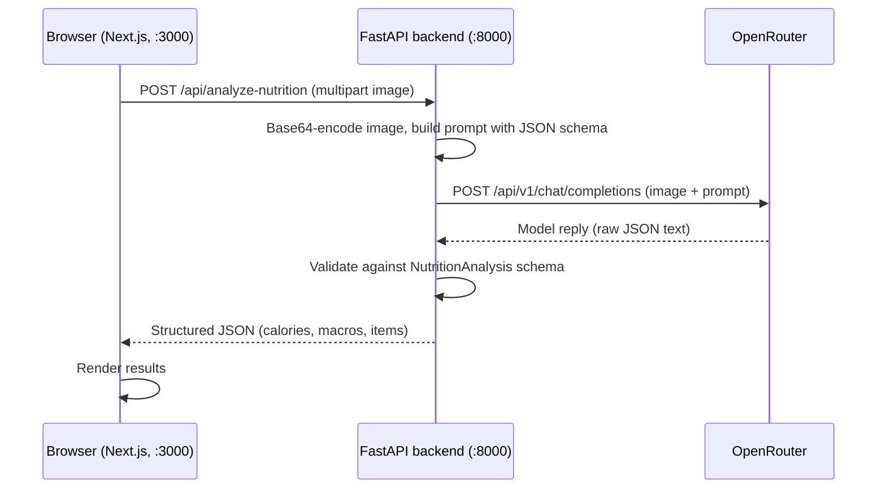

# See Food — AI Nutrition Agent

Upload a photo of a plate of food and get an instant estimate of its calories and macronutrients (protein, carbs, fats), broken down per detected ingredient.

The app has two parts:

- **Frontend** — a Next.js (React) single-page UI where you pick or drop a food photo and read the results.
- **Backend** — a FastAPI service that sends the photo to a vision-capable language model through [OpenRouter](https://openrouter.ai) and returns validated, structured nutrition data.

> **Heads up:** the numbers are AI-generated estimates based on a photo. They are not medical or dietary advice. The API includes a `disclaimer` field with every response and the UI displays it.

---

## Table of contents

1. [Features](#features)
2. [How it works](#how-it-works)
3. [Tech stack](#tech-stack)
4. [Project structure](#project-structure)
5. [Getting started](#getting-started)
6. [Configuration](#configuration)
7. [Deploying to Vercel](#deploying-to-vercel)
8. [API reference](#api-reference)
9. [Frontend behaviour](#frontend-behaviour)
10. [Testing](#testing)
11. [Troubleshooting](#troubleshooting)
12. [Known limitations](#known-limitations)

---

## Features

- Upload a food photo (PNG, JPG, WEBP — anything the browser reports as `image/*`) with an instant preview.
- One-click analysis that returns:
  - estimated total calories (kcal),
  - total protein, carbs and fats in grams,
  - a per-ingredient list with estimated portion weight, calories and macros,
  - a model confidence score and a disclaimer.
- Loading state while the model works, and clear error messages when something fails.
- Structured output enforced on the server: the model's answer is validated against a Pydantic schema before it reaches the UI.
- Interactive API docs generated by FastAPI.

## How it works



1. The browser sends the image as `multipart/form-data` under the field name `file`.
2. The backend base64-encodes it into a data URI and sends it to OpenRouter along with a system prompt that embeds the JSON schema the model must follow.
3. The model's reply is parsed and validated with Pydantic. Invalid output is rejected rather than passed through.
4. The frontend renders totals, macros and the ingredient table.

## Tech stack

| Layer    | Technology                                                                 |
| -------- | -------------------------------------------------------------------------- |
| Frontend | Next.js 15 (App Router), React 19, Tailwind CSS 3, `lucide-react` icons    |
| Backend  | Python, FastAPI, Uvicorn, Pydantic v2, `httpx`                             |
| AI       | OpenRouter chat-completions API (model set by `TARGET_MODEL` in `main.py`) |
| Tests    | pytest (backend), Vitest + React Testing Library (frontend), Playwright (end-to-end) |

## Project structure

```
see-food/
├── README.md
├── .gitignore
├── backend/
│   ├── main.py                 # FastAPI app: routes, schema, OpenRouter call
│   ├── vercel.json             # Vercel function settings (max duration)
│   ├── .env.example            # backend environment variables
│   ├── requirements.txt        # runtime dependencies
│   ├── requirements-dev.txt    # runtime + pytest
│   ├── pytest.ini
│   └── tests/
│       ├── test_main.py        # backend tests (OpenRouter call mocked)
│       └── e2e_server.py       # launcher for end-to-end tests (stubs OpenRouter)
└── frontend/
    ├── app/
    │   ├── layout.js           # root layout, imports global CSS
    │   ├── page.js             # the whole UI (upload, preview, results)
    │   ├── globals.css         # Tailwind directives
    │   └── lib/
    │       ├── config.js       # builds the backend URL from NEXT_PUBLIC_API_BASE_URL
    │       └── prepareImage.js # shrinks large photos before upload
    ├── .env.example            # frontend environment variables
    ├── tests/
    │   ├── setup.js            # Vitest setup
    │   ├── unit/               # component, config and image-compression tests
    │   └── e2e/                # Playwright end-to-end tests
    ├── package.json
    ├── tailwind.config.js
    ├── postcss.config.js
    ├── vitest.config.mjs
    └── playwright.config.js
```

## Getting started

### Prerequisites

- **Node.js 18.18 or newer** (required by Next.js 15; this project was tested on Node 22) and npm
- **Python 3** with pip (tested on Python 3.13)
- An **OpenRouter API key** — create one at [openrouter.ai](https://openrouter.ai)

### 1. Clone the repository

```bash
git clone https://github.com/Vignesh12041992/see-food.git
cd see-food
```

### 2. Start the backend

```bash
cd backend
python3 -m venv .venv
source .venv/bin/activate          # Windows: .venv\Scripts\activate
pip install -r requirements.txt

export OPENROUTER_API_KEY="your-key-here"   # Windows (PowerShell): $env:OPENROUTER_API_KEY="your-key-here"
python main.py
```

The API now listens on <http://localhost:8000>. Open <http://localhost:8000/docs> for interactive API docs.

You can also run it with auto-reload during development:

```bash
uvicorn main:app --reload --port 8000
```

### 3. Start the frontend

In a second terminal:

```bash
cd frontend
npm install
npm run dev
```

Open <http://localhost:3000>, choose a food photo and click **Analyze Food Plate**.

### Production build of the frontend

```bash
cd frontend
npm run build
npm run start      # serves on http://localhost:3000
```

## Configuration

| Setting              | Where                | Default                                           | Notes                                                                 |
| -------------------- | -------------------- | ------------------------------------------------- | --------------------------------------------------------------------- |
| `OPENROUTER_API_KEY` | environment variable | *(none — required)*                               | Without it, the analyze endpoint returns HTTP 500 with a clear message. |
| `TARGET_MODEL`       | `backend/main.py`    | `google/gemini-2.5-flash:free`                    | Any vision-capable OpenRouter model id. Availability is controlled by OpenRouter. |
| `OPENROUTER_URL`     | `backend/main.py`    | `https://openrouter.ai/api/v1/chat/completions`   | OpenRouter chat-completions endpoint.                                  |
| `ALLOWED_ORIGINS`    | environment variable (backend) | `http://localhost:3000`                 | Comma-separated list of web origins allowed to call the API (CORS). Add your deployed frontend address. |
| `APP_URL`            | environment variable (backend) | `http://localhost:3000`                 | Your frontend's public address; sent to OpenRouter as the `HTTP-Referer` attribution header. |
| `NEXT_PUBLIC_API_BASE_URL` | environment variable (frontend) | `http://localhost:8000`           | Where the backend lives. Read when the frontend is **built**, so redeploy the frontend after changing it. |
| Upstream timeout     | `backend/main.py`    | 45 seconds                                        | `httpx.AsyncClient(timeout=45.0)`.                                     |

Example files: [`backend/.env.example`](backend/.env.example) and [`frontend/.env.example`](frontend/.env.example). The backend does not load `.env` files by itself — export the variables in your shell or set them in your hosting provider. For the frontend, copy its example to `.env.local` for local development.

## Deploying to Vercel

The backend (Python/FastAPI) and the frontend (Next.js) are deployed as **two Vercel projects from this one repository**. Vercel gives every project a free `<project-name>.vercel.app` address, so no purchased domain is needed.

| Setting            | Backend project                                     | Frontend project                         |
| ------------------ | --------------------------------------------------- | ---------------------------------------- |
| Suggested name     | `see-food-api`                                      | `see-food`                               |
| Root Directory     | `backend`                                           | `frontend`                               |
| Framework          | FastAPI (detected from `main.py`)                   | Next.js                                  |
| Free address       | `https://see-food-api.vercel.app`                   | `https://see-food.vercel.app`            |
| Environment variables | `OPENROUTER_API_KEY`, `ALLOWED_ORIGINS`, `APP_URL` | `NEXT_PUBLIC_API_BASE_URL`               |

If a project name is already taken, Vercel adds a suffix to the address — use whatever address Vercel shows for your project.

**Steps**

1. **Create the backend project** (Vercel dashboard → *Add New…* → *Project* → import this repository → set **Root Directory** to `backend`). Add `OPENROUTER_API_KEY` as an environment variable and deploy. Copy its address.
2. **Create the frontend project** the same way with Root Directory `frontend`. Set `NEXT_PUBLIC_API_BASE_URL` to the backend address from step 1 and deploy. Copy its address.
3. **Allow the frontend to call the backend.** On the backend project set `ALLOWED_ORIGINS` and `APP_URL` to the frontend address (no trailing slash), then redeploy the backend. Environment variable changes only apply to new deployments.
4. **Check it works.** `curl https://<backend-address>/` should return `{"status":"online", …}`; then open the frontend address, pick a photo and click **Analyze Food Plate**.

**Using your own domain later:** in the frontend project open *Settings → Domains* and add it, then update `ALLOWED_ORIGINS` and `APP_URL` on the backend to the new address and redeploy the backend.

**Limits to know about**

- Vercel rejects request bodies over **4.5 MB**. The app shrinks large photos in the browser before uploading (see [Frontend behaviour](#frontend-behaviour)), so normal photos fit.
- The backend function may run for up to **60 seconds** (`backend/vercel.json`); the call to OpenRouter times out after 45 seconds.
- The API is public: anyone who finds its address can spend your OpenRouter quota. Consider rate limiting before sharing the link widely (Vercel's firewall offers rate-limiting rules; check what your plan includes).

## API reference

### `GET /`

Health check.

```json
{
  "status": "online",
  "message": "AI Nutrition Agent API is running. Use POST /api/analyze-nutrition to parse food images."
}
```

### `POST /api/analyze-nutrition`

Analyzes a food photo.

**Request** — `multipart/form-data` with one field:

| Field  | Type | Required | Description                 |
| ------ | ---- | -------- | --------------------------- |
| `file` | file | yes      | The food image to analyze.  |

```bash
curl -X POST http://localhost:8000/api/analyze-nutrition \
  -F "file=@/path/to/plate.jpg;type=image/jpeg"
```

**Success response — `200 OK`**

```json
{
  "detected_items": [
    {
      "name": "Grilled Chicken",
      "estimated_weight_g": 150,
      "calories": 248,
      "protein_g": 46.5,
      "carbs_g": 0.0,
      "fats_g": 5.4
    },
    {
      "name": "Brown Rice",
      "estimated_weight_g": 200,
      "calories": 216,
      "protein_g": 5.0,
      "carbs_g": 45.0,
      "fats_g": 1.8
    }
  ],
  "total_calories": 464,
  "total_protein_g": 51.5,
  "total_carbs_g": 45.0,
  "total_fats_g": 7.2,
  "confidence_score": 0.87,
  "disclaimer": "Estimates only. Not medical advice."
}
```

| Field                           | Type    | Description                                  |
| ------------------------------- | ------- | -------------------------------------------- |
| `detected_items[].name`         | string  | Food item name                               |
| `detected_items[].estimated_weight_g` | integer | Estimated portion weight in grams      |
| `detected_items[].calories`     | integer | Calories for that item (kcal)                |
| `detected_items[].protein_g`    | number  | Protein in grams                             |
| `detected_items[].carbs_g`      | number  | Carbohydrates in grams                       |
| `detected_items[].fats_g`       | number  | Fats in grams                                |
| `total_calories`                | integer | Total calories for the plate (kcal)          |
| `total_protein_g` / `total_carbs_g` / `total_fats_g` | number | Macro totals in grams |
| `confidence_score`              | number  | Model-reported confidence; the UI multiplies it by 100 and shows a percentage |
| `disclaimer`                    | string  | Text shown to the user alongside the results |

**Error responses**

| Status | When                                                                                                   |
| ------ | ------------------------------------------------------------------------------------------------------ |
| `422`  | The `file` field is missing or named differently.                                                      |
| `500`  | `OPENROUTER_API_KEY` is not set; OpenRouter returned an error or could not be reached; the model's reply was not valid JSON or did not match the schema. The `detail` field says which. |

Errors have the shape `{"detail": "<message>"}`.

## Frontend behaviour

- The **Analyze Food Plate** button stays disabled until an image is chosen, and while a request is in flight (no double submits).
- Choosing a new image clears the previous result and any previous error.
- A failed request shows a red error box with the server's message (`Server error: …`) or the browser's network error (for example `Failed to fetch` when the backend is not running).
- The results panel shows the calorie total, model certainty (rounded to a whole percent), protein/carbs/fats cards, the ingredient list and the disclaimer.
- **Large photos are shrunk in the browser** before upload. Photos up to 1.5 MB are sent unchanged. Larger ones are resized and re-encoded as JPEG, trying smaller settings until they fit under 3.5 MB, which keeps requests below Vercel's 4.5 MB limit. If a photo cannot be made small enough, or its format cannot be read by the browser and it is too big to send as-is, the UI says so instead of uploading.

## Testing

The project has three layers of tests. **93 tests in total.**

| Layer             | Tool                        | Count | What it covers                                                                                  |
| ----------------- | --------------------------- | ----- | ----------------------------------------------------------------------------------------------- |
| Backend           | pytest + FastAPI `TestClient` | 45  | Health check, success path, exact payload sent to OpenRouter, every error path, request validation, configurable CORS origins, Pydantic schema |
| Frontend (unit)   | Vitest + React Testing Library | 36 | Rendering, upload and preview, analyze flow, loading state, error states, photo compression logic, backend URL configuration |
| End-to-end        | Playwright (Chromium)       | 12    | Real browser → real Next.js app → real FastAPI backend, with only OpenRouter stubbed; includes uploading a ~9 MB photo and checking it is shrunk |

### Backend tests

```bash
cd backend
pip install -r requirements-dev.txt
python -m pytest
```

The outbound call to OpenRouter is replaced with a fake, so no API key or network access is needed.

### Frontend unit tests

```bash
cd frontend
npm install
npm test            # one run
npm run test:watch  # watch mode
```

### End-to-end tests

```bash
cd frontend
npm install
npx playwright install chromium     # one-time browser download
npm run test:e2e
```

Playwright starts everything it needs by itself:

1. `backend/tests/e2e_server.py` — runs the **real** FastAPI app on port 8000 and a small local stub of OpenRouter on port 9100. The stub decides what to answer from a `SCENARIO:<name>` marker inside the uploaded image bytes, so each test controls the upstream behaviour (success, slow response, HTTP 502, malformed model output) just by choosing what to upload. No production code is changed.
2. A production build of the Next.js app, served on port 3000.

Ports **3000, 8000 and 9100 must be free**, because the tests never reuse an already-running server (this avoids accidentally testing against your real backend). Optional environment variables:

| Variable           | Purpose                                                                 |
| ------------------ | ----------------------------------------------------------------------- |
| `E2E_PYTHON`       | Python executable used for the backend (default `python3`; use `python` on Windows). The packages from `backend/requirements.txt` must be installed for it. |
| `E2E_BROWSER_PATH` | Use an existing Chrome/Chromium binary instead of Playwright's download. |

The end-to-end tests also check that the Tailwind styles are actually applied, so a broken CSS setup fails the suite.

## Troubleshooting

| Symptom                                              | Likely cause and fix                                                                 |
| ---------------------------------------------------- | ------------------------------------------------------------------------------------ |
| UI shows `Failed to fetch`                           | The backend is not running on port 8000, or the frontend origin is not `http://localhost:3000`. |
| UI error mentions `OPENROUTER_API_KEY environment variable is not set` | Export the key in the same terminal before starting the backend.      |
| UI error mentions `OpenRouter Gateway Error`         | OpenRouter rejected the call (bad key, rate limit, unavailable model). The upstream status and body are in the message. |
| UI error mentions `Analysis engine failed`           | The model's reply was not valid JSON for the schema, or the request failed. Try again or try another model. |
| Page renders without any styling                     | Run `npm install` in `frontend/` (Tailwind and PostCSS must be installed) and restart `npm run dev`. |
| Browser blocks the request with a CORS error         | The frontend's address is missing from `ALLOWED_ORIGINS` on the backend. Add it (exact address, no trailing slash) and redeploy the backend. |
| Deployed site calls `localhost:8000`                 | `NEXT_PUBLIC_API_BASE_URL` was not set when the frontend was built. Set it and redeploy the frontend. |
| UI says the photo is too large                       | The photo could not be shrunk under the upload limit or the server returned HTTP 413. Try a smaller photo or a JPEG/PNG. |
| E2E tests fail to start with "port already used"     | Stop whatever is using ports 3000, 8000 or 9100.                                     |

## Known limitations

These are behaviours of the current code, listed so they are not a surprise:

- **Errors are always HTTP 500.** The analyze handler catches every exception, so an upstream status from OpenRouter (for example 401 or 429) is reported in the message text but the response status is 500.
- **Strict model output.** The model must return raw JSON matching the schema. Output wrapped in a markdown code fence is rejected, and `estimated_weight_g` must be a whole number (a fractional value such as `150.5` is rejected; `150.0` is accepted).
- **No upload validation on the server.** The backend does not check file size or confirm the file is an image; the whole file is base64-encoded into a single upstream request. (The browser shrinks large photos, but that protects only normal use of the UI, not direct API calls.)
- **Public, unauthenticated API.** There is no login or rate limiting, so a deployed backend can be called by anyone who knows its address.
- **Build-time backend URL.** `NEXT_PUBLIC_API_BASE_URL` is baked into the frontend when it is built; changing it needs a redeploy.
- **Free-tier model.** The default model id is a free-tier option on OpenRouter, which may be rate limited or change availability.
- **Estimates only.** Portion sizes and nutrition values come from a model looking at a photo and can be significantly off.
- **Housekeeping.** `pillow` is listed in `requirements.txt` and `io` is imported in `main.py`, but neither is used yet. The page title in `layout.js` is still the Next.js default.
